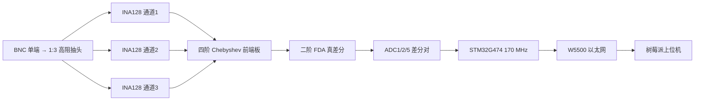

# 01 硬件

本卷写给做硬件评审与答辩的人：讲清信号链为什么这么搭、指标从哪来。只写板级定稿方案与实测指标，不写固件时序与上位机算法。读前请先翻一遍附录的硬件事实基线，器件位号都在那里。

## 系统方案

### 系统由哪几部分组成

三段：前端调理板、现有采集板、树莓派。前端板做一分三、阻抗变换与四阶抗混叠；现有板只把二阶 FDA 的截止频率从 450 kHz 调到 520 kHz；树莓派跑测量与显示。

### 为什么用伪差分输入

单端信号用 AGND 当负端，靠 FDA 转成真差分。这样 BNC 外壳不必浮地，共模由 FDA 的 VOCM 钉在 VREF/2，ADC 差分对直接吃到两倍摆幅。

### 为什么前端要升到四阶

二阶在 500 kHz 与 1 MHz 之间做不到既平又陡。二阶 fc=450 kHz 时 500 kHz 已掉 −4.02 dB，题 2 的 500 kHz 分量直接废掉；四阶才能把 1 MHz 压到 −38.390 dB。

### 四阶滤波器怎么分配两级

两级 Chebyshev，前级低 Q 后级高 Q，按 GBW=0.1×Q×fc 选运放。级联峰值 +0.714 dB@447 kHz，500 kHz 处 −0.545 dB，带内群延迟 1.5~2.6 µs。参数见滤波级参数表。

### 二级运放为什么余量很小

Stage2 需要 148.6153 MHz GBW，THS4551 标称 150 MHz，只剩 +0.93%。这是全板最紧的一处，退路是把通带从 490 kHz 降到 480 kHz 重算两级。

### 一分为三怎么做

三个高阻抽头并联取信号，不是电阻分压。三路 INA128 输入阻抗并联后约 3.3 MΩ，每路串 0/22 Ω 抑制尖峰。抽头不衰减，只做隔离，所以三通道增益完全一致。

### 增益档位怎么定

两级接力：INA128 给 ×2 或 ×20，FDA 固定 1.9606。合计 3.925 与 39.52 两档，见增益表。题 2/3 的 50~250 mVpp 只能用 ×2，×20 在 250 mVpp 就削顶。

### 采样位数够不够

够。50 mVpp 时 12 bit 只有 7.1 等效位，但 N=16384 的 FFT 单 bin 噪声仅 1.19 µV，对 ±5 mV 判据仍有 72 dB 余量。

### 前端板怎么供电

从现有板取 +5V(AGND) 与 −5V(AGND) 两组，不自带电源。−5V 由 LM2776 从 +5V 反相产生，专供 INA128 负轨。各轨来源见电源表。

### 模拟地怎么处理

AGND 与 DGND 在现有板上用 R73+R74 两个 0 Ω 并联单点桥接，PE 经 L11 磁珠接 DGND。前端板只接 AGND，验收时两板 AGND 电位差必须小于 1 mV。

### 屏和接口怎么改

屏换树莓派侧的 HDMI，板上 3.5 寸 TFT 只做本地调试。输入座改成板上直焊 BNC，取消 SMA。整机仍单路 5 V 供电，板上用升压产生 12 V 给继电器。

### 整机对外接口有哪些

一路 BNC 输入、一路以太网、一路 USB-C 供电，外加树莓派侧的 HDMI 与触摸。整机只有一个信号入口，通道选择全在内部继电器上做。

### 为什么要 12 V 升压

继电器 G6K-2F-Y 是 12 V 线圈，板上用升压从 5 V 抬到 12 V。对外仍是一路 5 V 输入，符合单路供电的硬性说明。

### 电源为什么要多级 LDO

数字与模拟分开供，模拟再经 TPS7A9401 低噪 LDO，基准单独由 MAX6071 经磁珠供给。级数多换来的是 VREF 上的纹波小到不影响 12 bit 底噪。

### Sallen-Key 怎么接

运放 IN− 直接接 AGND，C1 跨输出与中间节点，C2 从中间节点到 AGND。这样每级只有一只运放，四阶就是两级串起来。

### 为什么不搬直流电平

全链路直流耦合，前级不加减偏置，共模统一由 FDA 的 VOCM 钉在 VREF/2。少一次搬电平就少一个失调与漂移源。

### 前端板怎么验收入库

三件事：两板 AGND 电位差小于 1 mV、447 kHz 处峰值不过 +1 dB、1 MHz 抑制深于 −32 dB。三项全过才装整机，三块板必须同批 C0G 才有可比曲线。

### 二阶 FDA 的增益怎么定

Rf=2.49 kΩ、Rg=1.27 kΩ，闭环 1.96。它同时决定 ωn=640.0 kHz 与 Q=0.863，改增益必须重算 C1/C2，不能只换电阻。

### 跳线 H1/H2/H3 干什么

旁路 AD8608 那级准静态 TIA。TIA 的 Rf=1 MΩ 并 4.7 nF，带宽约 34 Hz，只服务直流与慢变量；交流通路一律短接跳线。

### 为什么板上还留小屏

3.5 寸 480×350 TFT 只做本地调试和不接树莓派时的降级显示。正式测量走 HDMI，触摸仍走 FT6336。

### 差分对为什么要串阻容

每对 ADC 输入串 33 Ω 再并 100 pF，做电荷缓冲与限流。33 Ω 挡住采样瞬间的注入电流，100 pF 吸收电荷尖峰，少一个高位就跳码。

### 基准为什么选 3.0 V

MAX6071 的 3.0 V 作 VREF+，配伪差分正好把 ±765 mV 映射到满量程。基准再高浪费码值，再低就用不满 ×2 档的摆幅。

### 板级改动有哪几项

三项：屏换 HDMI 大屏、输入改直焊 BNC、12 V 改板上升压。前两项对应硬性说明里的屏尺寸与接口要求，第三项保住单路 5 V 供电。

| 原设计 | 问题 | 定稿做法 |
|---|---|---|
| 3.5 寸 TFT | 不满足屏 ≥6" | 树莓派 HDMI 输出 |
| SMA 座 | 不符合焊接要求 | 板上直焊 BNC |
| 12 V 继电器 + USB-C PD | 破坏单路 5 V | 板上 5 V 升 12 V |

## 指标

| 项目 | 数值 | 条件 |
|---|---|---|
| 通带 | 490 kHz | 0.5 dB 纹波 |
| 500 kHz 衰减 | −0.545 dB | 相对 10 kHz |
| 峰值 | +0.714 dB @447 kHz | 级联实测 |
| 1 MHz 抑制 | −38.390 dB | 要求 ≥32 dB，余量 6.39 dB |
| 带内群延迟 | 1.5~2.6 µs | 四阶前端 |
| 200 mVpp 干扰残留 | 2.41 mVpp | 1 MHz 单频 |
| 通道增益 | 3.925 / 39.52 | ×2 档 / ×20 档 |
| 单端输入范围 | ±765 mV / ±76 mV | 对应上述两档 |

## 频率响应

| 频率 | 相对增益 | 条件 |
|---|---|---|
| 10 kHz | +0.004 dB | 级联实测 |
| 100 kHz | +0.308 dB | 级联实测 |
| 200 kHz | +0.659 dB | 级联实测 |
| 447 kHz | +0.714 dB | 峰值 |
| 500 kHz | −0.545 dB | 通带边缘 |
| 1 MHz | −38.390 dB | 干扰抑制 |

## 赛题要求对照

| 项目 | 赛题要求 | 本板能力 |
|---|---|---|
| 题1 基波 | 100~250 mVpp，10k~200k | 通带 490 kHz，×2 档覆盖 |
| 题2 基波 | 50~250 mVpp，10k~500k | 500 kHz 处 −0.545 dB，仍可用 ×2 档 |
| 题3 干扰 | 单频 200 mVpp，f3≥1 MHz | 1 MHz 抑制 −38.390 dB，残留 2.41 mVpp |
| 判据 | Upp/Urms ≤5 mV、f1 ≤1 kHz、分量 ≤5 mV | 实测 ΔUpp −4.36~+1.63 mV |
| 时长 | 每项 ≤2 s | 最坏 300 ms |

## 滤波级参数

| 级 | fc | Q | 需要 GBW | 运放 | 实配 GBW |
|---|---|---|---|---|---|
| Stage1 | 292.5312 kHz | 0.705 | 20.6234 MHz | THS4521 | 145 MHz |
| Stage2 | 505.3225 kHz | 2.941 | 148.6153 MHz | THS4551 | 150 MHz |
| 二阶 FDA | 640.0 kHz（ωn） | 0.863 | — | THS4521 | 145 MHz |

Stage2 的 fc = 1.031270 × 通带频率，换通带时按这个比例重算。FDA 实测 −3 dB 在 751.68 kHz。

## 元件

| 位置 | R1=R2 | R3 | C1 | C2 |
|---|---|---|---|---|
| Stage1 | 3.92 kΩ | 1.96 kΩ | 100 pF | 200 pF |
| Stage2 | 536 Ω | 274 Ω | 100 pF | 3.3 nF |
| 二阶 FDA | 1.15 kΩ | 866 Ω | 100 pF | 300 pF |

电阻用 E96 1%，电容用 C0G。FDA 增益 1.96 由 Rf=2.49 kΩ 与 Rg=1.27 kΩ 定，差分两臂的 C1 必须成对同批。

## 增益

| 档 | INA128 | FDA | 合计 | 单端满幅 | 适用 |
|---|---|---|---|---|---|
| ×2 | 2.002 | 1.9606 | 3.925 | ±765 mV（1531 mVpp） | 全部题 |
| ×20 | 20.157 | 1.9606 | 39.52 | ±76 mV（152 mVpp） | 仅 50 mVpp 以下 |

## 关键器件

| 位号 | 型号 | 作用 |
|---|---|---|
| U19/U22/U25 | INA128 | 三路仪表放大，×2 / ×20 |
| U18/U21/U24 | BL1551B | 切 R_G 选增益 |
| U20/U23/U26 | THS4521 | 二阶 FDA 与前端 Stage1 |
| U30 | AD8608 | 四路准静态 TIA，约 34 Hz |
| U3 | MAX6071BAUT30 | 3.0 V 基准 |
| U7 | W5500 | 以太网 MAC+PHY |
| U5 | W25Q16 | 参数与快照存储 |
| U11 | CH224A | USB-C PD 诱取 12 V |

## 电源

| 轨 | 来源 | 主要负载 |
|---|---|---|
| +12 V | CH224A PD 诱骗 / XT60 | 6 只 G6K-2F-Y 继电器 |
| +5 V (DGND) | TPS7A4701 | 数字、W5500、屏 |
| +5 V (AGND) | TPS7A4701 独立输出 | INA128、FDA |
| −5 V (AGND) | LM2776 反相 | INA128 负轨 |
| 3.3 V | AP2112K-3.3 | MCU、Flash、触摸 |
| 3.0 V | MAX6071 经 L3 磁珠 | VREF+ |

## 外设连接

| 功能 | 引脚 |
|---|---|
| SPI1（W25Q16）SCK/MISO/MOSI/CS | PB3 / PB4 / PB5 / PB6 |
| SPI2（ILI9488）SCK/MISO/MOSI/CS | PB13 / PB14 / PB15 / PB12 |
| SPI3（W5500）SCK/MISO/MOSI/CS | PC10 / PC11 / PC12 / PA15 |
| W5500 INT / RST | PB7 / PD2 |
| LCD_DC / LCD_RST / LCD_LED(PWM) | PB10 / PB2 / PB11（TIM2_CH4） |
| I2C3（FT6336）SCL/SDA | PC8 / PC9 |
| 触摸 INT / RST | PC6（EXTI6）/ PC7 |
| USART1 TX/RX（调试） | PC4 / PC5，115200 8N1 |
| AFE 通道1 ATT / AC-DC / PGA_EN | PB9 / PC13 / PC3 |
| AFE 通道2 ATT / AC-DC / PGA_EN | PA2 / PA3 / PA4 |
| AFE 通道3 ATT / AC-DC / PGA_EN | PA5 / PB0 / PB1 |
| 编码器开关 | PA10（ENC1_SW）、PC2（ENC2_SW） |
| ADC1 / ADC2 / ADC5 差分对 | PA0-PA1 / PA6-PA7 / PA8-PA9 |

> 现象：CubeMX 里 PB3/4/5 标 SPI1、PC10-12 标 SPI3，看着像 W5500 在 SPI1。
> 原因：Flash 与 W5500 的引脚对调过一轮，`.ioc` 标签沿用了旧名。
> 做法：以代码为准——Flash 用 `hspi1`、CS=PB6；W5500 用 `hspi3`、CS=PA15。

## 踩过的坑

> 现象：500 kHz 分量测出来偏低 3.4%，题目直接判超差。
> 原因：二阶 FDA 的 fc 只有 450 kHz，500 kHz 处衰减 −4.02 dB。
> 做法：fc 提到 520 kHz，前端再加四阶，把 500 kHz 压到 −0.545 dB。

> 现象：换上前端板后基线漂移，小信号读数比仿真差一截。
> 原因：两板 AGND 之间有几十 mV 电位差，被 INA128 的 39 倍增益放大。
> 做法：AGND 单点相连，装板后实测两板地电位差 <1 mV 才验收。

> 现象：同批板子的通道间幅频曲线对不上，差 0.5 dB。
> 原因：C1/C2 用了不同批次的 5% 电容，Q 值偏差被 Stage2 放大。
> 做法：C0G、1%、成对采购，两臂电容同批同容值。
