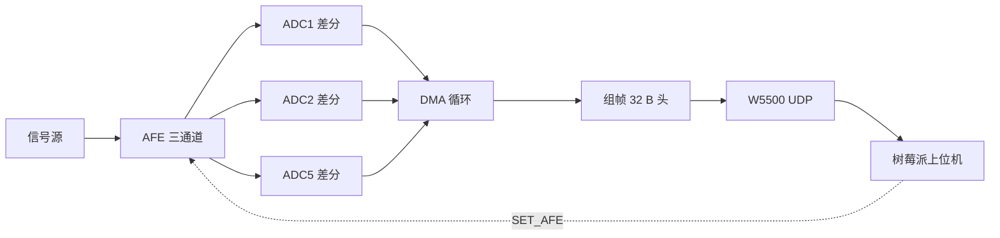

# 02 固件

本卷写给做固件评审与联调的人：讲 170 MHz 下三路差分采样、换档、组帧与上传怎么落地。只写 STM32G474 侧，硬件见 01 卷、上位机见 03 卷、信号源见 04 卷；读前先看 01 卷外设表。

## 采集链路



## 器件与时钟

### 主控与时钟是什么

一颗 STM32G474RET6，LQFP64 封装，HSE 25 MHz 经 PLL 倍到 170 MHz。CPU、总线、三个 ADC 与 TIM8 同频，触发到采样的延迟固定。

| 项 | 值 |
|---|---|
| MCU | STM32G474RET6，LQFP64 |
| 存储 | 512 KB Flash，96 KB SRAM，32 KB CCM |
| HSE | 25 MHz |
| PLL | M=5，N=68，P=2 |
| SYSCLK / HCLK | 170 MHz |
| APB1 / APB2（TIM） | 170 MHz |
| ADC12 / ADC345 | 170 MHz |

### 采样 tick 是多少

TIM8 的计数时钟由 170 MHz 八分频得到，一个 tick 就是它的倒数。重装值写 ARR=P−1，一个采样周期正好 P 个 tick。

| 项 | 值 |
|---|---|
| 计数时钟 | 21.25 MHz（170/8） |
| 一个 tick | 47.06 ns |
| 重装值 | ARR=P−1 |

### 三相触发怎么分配

三路共用一个计数器，两个比较值把相位错开；CC1/CC2 只产生内部事件，不接引脚。

| 相位 | 触发源 | 触发路径 | 比较值 |
|---|---|---|---|
| 0 | MMS=UPDATE | TRGO → ADC1 | — |
| 2 | CH2/OC2REF | TRGO2 → ADC5 | CCR2=P/3 |
| 1 | CH1/CC1 | CC1 → ADC2 | CCR1=2P/3 |

## 档位与模式

### 档位表怎么定

四档写在 `s_p_tbl[4]={6,8,10,12}` 里，只差 P，采样率与 Nyquist 见下表。

| 档 | P（tick） | 单路 fs | Nyquist |
|---|---|---|---|
| 0 | 6 | 3.542 MSPS | 1.77 MHz |
| 1 | 8 | 2.656 MSPS | 1.33 MHz |
| 2 | 10 | 2.125 MSPS | 1.06 MHz |
| 3 | 12 | 1.771 MSPS | 0.885 MHz |

### 三种模式怎么选

模式 0 单路、1 三路软件交织、2 双 ADC 硬件交织，后两者把返回采样率分别乘 3 和乘 2。

| 模式 | 做法 | 返回 fs | 结论 |
|---|---|---|---|
| 0 | 单路触发 | fs | 采用 |
| 1 | 三路相位错开软件交织 | fs×3 | 镜像落在 fs/3±f，弃用 |
| 2 | 双 ADC 硬件交织 | fs×2 | 间隔一整个周期，弃用 |

实际只用模式 0，另两种的镜像与间隔问题见上表。

### 换档怎么停表

改 ARR/CCR 前必须停计数器，否则会多出一拍畸形触发。

```c
__HAL_TIM_DISABLE(&htim8);
htim8.Instance->ARR  = P - 1;
htim8.Instance->CCR1 = (P / 3) * 2;   /* ADC2，相位 1 */
htim8.Instance->CCR2 = P / 3;         /* ADC5，相位 2 */
htim8.Instance->CNT  = 0;
htim8.Instance->EGR  = TIM_EGR_UG;    /* 立即装入新值 */
```

停表、改值、清零、UG 重载四步顺序固定；启动采集时先把 CNT 置到 ARR 再使能，第一拍就溢出。

## ADC

### 差分通道怎么接

三路都走真差分，负端接相邻通道，采样时间统一 2.5 周期。

| ADC | 通道 | 差分对 | 采样时间 |
|---|---|---|---|
| ADC1 | IN1 | PA0 / PA1 | 2.5 周期 |
| ADC2 | IN3 | PA6 / PA7 | 2.5 周期 |
| ADC5 | IN1 | PA8 / PA9 | 2.5 周期 |

### 为什么关连续转换

一次触发只采一个点，节奏完全由 TIM8 决定；DMA 用循环模式，写满就覆盖最旧数据。三路各占一条 DMA 通道，三路都置完成位才放行一帧，任一路丢中断就整帧作废。

```c
hadc1.Init.ContinuousConvMode    = DISABLE;
hadc1.Init.DMAContinuousRequests = ENABLE;
hadc1.Init.Overrun               = ADC_OVR_DATA_OVERWRITTEN;
```

### 数据怎么解码

ADC 输出是偏移二进制，减掉零点才是有符号码；按补码解会把小信号整段翻正。

```c
int16_t v = (int16_t)code - 2048;   /* 偏移二进制，不是补码 */
```

## 通信协议

### 网络怎么连

板子地址与上位机网段见下表，控制与数据同端口，都走 UDP。

```text
板子   192.168.57.200:5000   UDP
上位机 192.168.57.50/24      eth0，never-default
```

### 命令帧是什么

16 B 定长，magic 为 `LSCO`，字段按小端排。

`struct "<I6BHI"`

| 偏移 | 长度 | 字段 |
|---|---|---|
| 0 | 4 | magic = 0x4F43534C |
| 4 | 1 | cmd |
| 5 | 1 | a0 |
| 6 | 1 | a1 |
| 7 | 1 | a2 |
| 8 | 1 | a3 |
| 9 | 1 | rsv |
| 10 | 2 | n |
| 12 | 4 | tok |

### 数据帧头是什么

32 B，magic 为 `LSDA`，字段与偏移见下表。

`struct "<I4B5IHH"`

| 偏移 | 长度 | 字段 | 说明 |
|---|---|---|---|
| 0 | 4 | magic | 0x4144534C |
| 4 | 1 | ver | 版本，当前 1 |
| 5 | 1 | typ | 0=ACK，1=DATA，2=ERR |
| 6 | 1 | gear | 档位 0~3 |
| 7 | 1 | mode | 0/1/2 |
| 8 | 4 | fs_hz | 实际采样率 |
| 12 | 4 | n_total | 本帧总点数 |
| 16 | 4 | n_this | 本包点数 |
| 20 | 4 | gain_milli | 总增益×1000 |
| 24 | 4 | tok | 令牌回显 |
| 28 | 2 | flags | 标志位 |
| 30 | 2 | crc | CRC-16 |

### CRC 怎么算

帧头前 30 B 与载荷一起算，上位机 `host/lsa_proto.py` 用同一份实现；缺包按 tok 与 n_total/n_this 判别，整帧作废重采。

```c
/* CRC-16/CCITT-FALSE: poly=0x1021, init=0xFFFF, refin=false, refout=false */
```

### 命令码有哪些

0x01~0x10 分成采集、AFE、参数区、日志区四组。

| 码 | 命令 | 码 | 命令 |
|---|---|---|---|
| 0x01 | PING | 0x09 | PARAM_COMMIT |
| 0x02 | CAPTURE | 0x0A | PARAM_LOAD |
| 0x03 | STATUS | 0x0B | PARAM_INFO |
| 0x04 | ABORT | 0x0C | PARAM_CLEAR |
| 0x05 | SET_AFE | 0x0D | LOG_PUT |
| 0x06 | SELFTEST | 0x0E | LOG_INFO |
| 0x07 | PARAM_BEGIN | 0x0F | LOG_READ |
| 0x08 | PARAM_CHUNK | 0x10 | LOG_CLEAR |

### 标志位代表什么

两个位：交织自检通过与本次采集出错。

| 标志 | 值 | 含义 |
|---|---|---|
| FLAG_INTER3_OK | 0x0001 | 三路交织自检通过 |
| FLAG_ERROR | 0x0002 | 本次采集有错误 |

### SET_AFE 怎么控制

a1 切耦合，a2 切衰减，a3 切增益；两个 20× 同时打开时总增益回到 ×1，不是 400×。

| 参数 | 取值 | 含义 |
|---|---|---|
| a1 | 0 / 1 | DC / AC 耦合 |
| a2 | 0 / 1 | 1× / 20× 衰减 |
| a3 | 0 / 1 | 1× / 20× 增益 |

## AFE 控制

### AFE 三路怎么接

每通道三个 GPIO，默认低电平是直通态。

| 通道 | ATT | AC-DC | PGA_EN |
|---|---|---|---|
| 1 | PB9 | PC13 | PC3 |
| 2 | PA2 | PA3 | PA4 |
| 3 | PA5 | PB0 | PB1 |

切耦合继电器后要等它稳定再启动 CAPTURE；调试时只动一位，避免衰减与增益互相抵消。

## 代码结构

| 文件 | 文件 |
|---|---|
| `firmware/Drivers/App/sample_clock.c` | `firmware/Drivers/App/scope_acq.c` |
| `firmware/Drivers/App/param_store.c` | `firmware/Drivers/App/log_store.c` |
| `firmware/Drivers/ADC/adc_driver.c` | `firmware/Drivers/AFE/afe.c` |
| `firmware/Drivers/W5500/bsp_w5500.c` | `firmware/Drivers/W5500/w5500_network.c` |
| `firmware/Drivers/Flash/w25qxx.c` | `firmware/Drivers/TFT_Screen/ILI9488.c` |
| `firmware/Drivers/Touch/ft6336.c` | `firmware/Drivers/debug_print/debug_print.c` |
| `firmware/Core/Src/adc.c` | `firmware/Core/Src/spi.c` |
| `host/lsa_proto.py` | — |

## 踩坑

> 现象：`sample_clock.c:12-17` 的注释写 `{8,10,12,16}`，照注释改档位就采错。
> 原因：代码里的 `s_p_tbl` 实际是 `{6,8,10,12}`，注释是上一轮扫描留下的。
> 做法：以 `s_p_tbl` 为准，改档只动这张表。

> 现象：P=6 档用 256 点探针看一切正常，真实采集却隔一次触发才转换，100 kHz 被读成 200 kHz。
> 原因：探针太短，看不出 ADC 还没转换完下一次触发就到了。
> 做法：采样时间固定 2.5 周期，验收改用整帧采集，不再拿短探针下结论。

> 现象：只置 `CCER` 的 CC1E/CC2E 就能出触发，一调 `HAL_TIM_PWM_Start` 反而把 PC6/PC7 占了。
> 原因：HAL 的 `HAL_TIM_PWM_MspInit` 会把这两个脚配成复用输出，和触摸 INT/RST 冲突。
> 做法：不调 `HAL_TIM_PWM_Start`，只置 `CCER` 位产生内部 CC/OC 事件。
