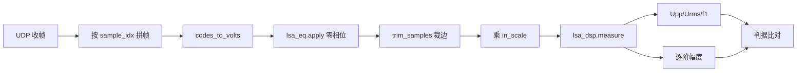

# 03 软件

本卷写给改上位机与答辩演示的人：讲清树莓派侧从收包到出数的每一步。只写测量链、判据与现场开关。固件时基见 02 卷，DG4202 指令见 04 卷。读前记住一条：所有幅度先用裸码算，再统一乘标定系数。

## 测量链



顺序固定，不能调换：

```python
v = lsa_proto.codes_to_volts(raw)      # 裸码 → 电压
if eq:
    v = lsa_eq.apply(v, fs, eq)        # 零相位频响补偿
margin = eq.trim_samples(fs)           # 裁掉卷积边
v = v * cfg.get_in_scale()             # 整链比例系数
r = lsa_dsp.measure(v, fs, margin)     # 拟合 / 分位数
```

## 模块

| 模块 | 职责 |
|---|---|
| `lsa_proto.py` | UDP 收发、CRC、命令封装 |
| `lsa_dsp.py` | 最小二乘拟合、谱分析、判据 |
| `lsa_eq.py` | 幅频补偿与裁边 |
| `lsa_touch.py` | 触摸交互与 `StepCalib` 验收 |
| `dg4202.py` | DG4202 驱动（USBTMC / 谐波 / ARB） |
| `_contest_one.py` | 单次测量流程串联 |

## 采集与拼帧

### 为什么用 UDP 不用 TCP

测量只要最新一窗数据，丢包就重采，不需要 TCP 的重传与拥塞控制。UDP 省掉三次握手与 ACK，单帧往返压在毫秒级，固件侧也简单。

### 怎么把包拼成波形

每包带 `sample_idx`，按序号写进定长数组，不动顺序。缺口就是缺口，绝不插值补点，否则相位与谐波全歪。

### 为什么每 8 秒发 PING

固件空闲 120 s 会强制关连接，PING 周期必须远小于它。8 s 一次既保活又不占带宽，断链最多 8 s 被发现。

### 接收缓冲怎么设

`sysctl rmem_max` 改到 16777216，Socket 的 `SO_RCVBUF` 设 8 MB。3 通道 8192 点突发在百毫秒级，缓冲不够会丢包重传。

### 数据怎么换算成电压

`codes_to_volts` 把裸码按偏移二进制转电压，再乘前端增益 3.925。这一步只用常数，不做频响修正，修正留给 EQ。

## 幅度与频率

### 为什么补偿要零相位

只改幅频不动相位，`comp = min(1/|H|, 10^(24/20))`。24 dB 限幅防表外噪声，`f_hi` 取 550 kHz，再往上按 0.25·f_hi 收口到 1.0。

### 为什么要裁边

EQ 是循环卷积，首尾会卷进对方的数据。`trim_samples` 按 fs 算出保护带，裁掉后 N≈13196，频率分辨率 Δf=268 Hz。裁少了低频泄漏，裁多了点数不够。

### 幅度怎么拟合

先做 1..K 阶最小二乘拟合（`band_hi=520 kHz`）。残差 ≤ `fit_resid_max` 用拟合 `upp`；中间区走 `fit_diag`（5 mV 绝对预算）；再不行退回 0.1/99.9 分位数。

### 逐阶幅度怎么取

`harmonic_amplitudes(v, fs, f1, count, tol=0.03)`，在每阶理论频点附近取峰。`tol` 是相对容差，用来吸收 FFT 栅栏效应。

### 频率怎么定

三点抛物线插值，用峰及其左右两 bin 的幅值算偏移。分辨率 268 Hz 时插值后能稳在 ±1 kHz 判据内。

### 波形类型怎么判

看 2、3 次谐波与基波的比例，方波看奇次、三角看奇次反相、半波看偶次。

> 现象：基频高于 167 kHz 时波形类型判断瞎报。
> 原因：判型要看 3 次谐波，f1 过 167 kHz 后 3f1 已经出校准带。
> 做法：f1>167 kHz 只报幅度与频率，不报类型。

## 窗函数与判据

### 窗函数怎么选

测幅度用 Flat-top，测谐波用 Blackman-Harris。两者都要做相干增益补偿 `sum(w)/N`，否则幅度整体偏低几个百分点。

### 判据不过怎么查

先看拟合残差，残差大是波形或 EQ 的问题；残差小但 ΔUpp 大是标定系数漂了。再对同一组数据跑分位数法，两法差得多说明该放宽门限。

### 判据怎么自动比对

`StepCalib.TEST_CASES` 存每个用例的标称 Upp、Urms、f1 与各阶幅度，测完逐项求差。五项全在 5 mV / 1 kHz 内才算通过，任一超差直接标红。

### 分位数法是什么

取样本 0.1% 与 99.9% 分位当负峰与正峰，差值即 Upp。它对毛刺不敏感，但会系统性抬高小信号，所以只作拟合失败时的兜底。

### 干扰项怎么构造

干扰用 ARB 发，因为 41×F0、35×F0 不是基波整数倍，谐波模式做不出来。幅值 200 mVpp、单频，叠加在基波上一起测。

### PING 为什么不更频繁

PING 占带宽也占固件中断，1 s 一次换不来收益。8 s 周期对 120 s 的空闲门限有 15 倍余量，断链迟滞也能接受。

### 测量结果存哪

每次测量把基线、电压、EQ 系数、拟合残差与判据结果写进 CSV 与日志目录。复现某次超差时按时间戳回查，不再重测。

### 单次测量耗在哪

340~420 ms 里，收满一帧占大头，FFT 与拟合占不到三分之一。刷新频率的瓶颈是网络往返，不是算法。

### 幅频表怎么用

表里是频率与复增益的对应点，中间频率线性插值。表尾 550 kHz 之上没有测点，EQ 自动收口到 1.0，不再外推。

### 触摸界面做什么

一页放实时 Upp/Urms/f1 与逐阶柱状图，另一页放 `StepCalib` 用例表与单步执行按钮。答辩时点单步，结果直接对着判据表看。

| 判据项 | 门限 | 实测最差 |
|---|---|---|
| ΔUpp | ≤5 mV | −4.36 mV |
| ΔUrms | ≤5 mV | 5 mV 内 |
| Δf1 | ≤1 kHz | 1 kHz 内 |
| 逐分量 | ≤5 mV | 0.9 mV |

## 校准

### 标定怎么做

四步：输入端短路读 offset；加 100 mV DC 反推 G_x2 与 G_x20；500 mV 扫线性度看 R²；三通道各存一套系数。系数存 `cfg`，`in_scale` 当前值 0.3915。

### 幅频表怎么测

10k~550k 共 19 个点，每点记录幅度比与相位。补偿后 100k/300k/500k 三点都回到 250.0±0.1 mV。

### 重复性怎么样

500 kHz、250 mVpp 连测 10 帧，σ=0.020 mV，极差 0.064 mV。扫频绝对误差 −0.003~+0.156 mV，波形识别偏差 方波 +0.001、三角 −0.177、半波 −0.000 mV。

### 为什么先 EQ 再乘系数

EQ 只补频响形状，系数只做整体比例，两者不耦合。顺序反了会让补偿表里混进增益，换档就得重测。

### 三通道怎么分别标定

每路存一套 `in_scale` 与幅频表，键是通道号。三路前端元件容差不同，共用一套系数会让通道间差出 0.5 dB。

### 为什么用拟合不用峰值

峰值法只看一个 bin，受栅栏效应与噪声影响大。最小二乘把 1..K 阶一起解，残差还能当质量指标，拟合不可信时才知道该退回分位数法。

## 关键参数

| 参数 | 值 | 说明 |
|---|---|---|
| `in_scale` | 0.3915 | 整链电压换算 |
| `band_hi` | 520 kHz | 拟合带限 |
| `fit_resid_max` | 0.15 | 现场放宽值 |
| `fit_resid_loose` | 0.12 | 残差超此值直接退分位数法 |
| EQ `f_hi` | 550 kHz | 校准表末点 |
| EQ 补偿上限 | 24 dB | `10^(24/20)` |

## 现场开关

| 变量 | 值 | 只对 DG4202 生效 |
|---|---|---|
| LSA_EQ_FHI_HZ | 520000 | 是 |
| LSA_EQ_LP_HZ | 520000 | 是 |
| LSA_FIT_RESID_MAX | 0.15 | 是 |

> 现象：接 DG4202 时 Upp 虚高 60~90 mV，换信号源就正常。
> 原因：DG 在 585~600 kHz 有约 6 mV 固定残留，EQ 在该处补到 ×7.12。
> 做法：EQ 上带限到 520 kHz，残留回落到 ±1~10 mV。

> 现象：50~150 mVpp 小信号系统性偏高，拟合与分位数差 11 mV。
> 原因：残差刚过 0.03，退回分位数法本身会抬高 Upp。
> 做法：残差门限放宽到 0.15，同组数据拟合 250.06 mV、分位数 261.12 mV，取拟合。

## 验收

判据：`|ΔUpp|≤5 mV`、`|ΔUrms|≤5 mV`、`|Δf1|≤1 kHz`、逐分量 ≤5 mV。`StepCalib.TEST_CASES` 九个用例加干扰项，10/10 通过。

| 用例 | ΔUpp (mV) | 模式 |
|---|---|---|
| 题1-A | +0.20 | 谐波 |
| 题1-B | +0.12 | 谐波 |
| 题1-C | +1.63 | 谐波 |
| 题1-D | +1.21 | 谐波 |
| 题2-A | −4.36 | 谐波 |
| 题2-B | −0.70 | 谐波 |
| 题2-C | −4.02 | 谐波 |
| 题2-D | −0.48 | ARB |
| 题3-A | −2.91 | ARB |
| 题3-B | +1.22 | ARB |

F0 = 29296.875 Hz（120 MHz/4096）。题2-D 的 17 次超出谐波上限 16，题3-A/B 的干扰非基波整数倍，只能走 ARB。

| 指标 | 数值 |
|---|---|
| 刷新周期 | 340~420 ms |
| 频率分辨率 | 268 Hz（裁边后 N≈13196） |
| Upp 重复性 | σ=0.020 mV @500 kHz/250 mVpp |
| 扫频绝对误差 | −0.003~+0.156 mV |
| 分量最大偏差 | 0.2~0.9 mV |
