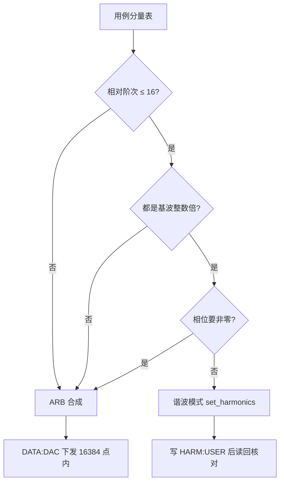

# 04 外设驱动

本卷写给改驱动与排硬件故障的人：逐个外设讲实现与踩过的坑，重点是 DG4202 的 SCPI 方言。只写已跑通的驱动行为与实测结论；位号见附录硬件事实基线，引脚见 01 卷外设表，采样时基见 02 卷。

## 外设一览

| 外设 | 接口 | 驱动位置 | 关键参数 |
|---|---|---|---|
| W25Q16 | SPI1 | `firmware/Drivers/Flash/w25qxx.c` | 2 MB，4 KB 扇区，CS=PB6 |
| ILI9488 | SPI2 | `firmware/Drivers/TFT_Screen/ILI9488.c` | 4 bit 数据，CS=PB12 |
| FT6336 | I2C3 | `firmware/Drivers/Touch/ft6336.c` | 地址 0x38，INT=PC6 |
| W5500 | SPI3 | `firmware/Drivers/W5500/bsp_w5500.c` | CS=PA15，INT=PB7，RST=PD2，prescaler /4 |
| ADC1/2/5 | 片内 | `firmware/Drivers/ADC/adc_driver.c` | 差分，2.5 周期，170 MHz |
| AFE | GPIO | `firmware/Drivers/AFE/afe.c` | 3 通道，1×/20× |
| DG4202 | USBTMC | `host/dg4202.py`、`host/lsa_src.py` | 双通道，USB 直连 |

### 引脚以什么为准

以代码为准；`.ioc` 的标签沿用旧名，和现在的接线对不上。

| 外设 | 总线 | 引脚 |
|---|---|---|
| W25Q16 | SPI1 | SCK/MISO/MOSI/CS = PB3/PB4/PB5/PB6 |
| ILI9488 | SPI2 | SCK/MISO/MOSI = PB13/PB14/PB15，CS=PB12，DC=PB10，RST=PB2，背光=PB11(TIM2_CH4) |
| W5500 | SPI3 | SCK/MISO/MOSI = PC10/PC11/PC12，CS=PA15，INT=PB7，RST=PD2 |
| FT6336 | I2C3 | SCL/SDA = PC8/PC9，INT=PC6(EXTI6)，RST=PC7 |

> 现象：`.ioc` 里 PB3/4/5 标 SPI1、PC10-12 标 SPI3，看着像 W5500 在 SPI1。
> 原因：Flash 与 W5500 的引脚对调过一轮，`.ioc` 标签沿用旧名。
> 做法：以代码为准——Flash 用 `hspi1`、CS=PB6；W5500 用 `hspi3`、CS=PA15。

## W25Q16 Flash

### Flash 怎么读写

按扇区擦、按页写，写前必须擦干净，页写不能跨页边界。

| 项 | 值 |
|---|---|
| 容量 | 2 MB |
| 页 | 256 B |
| SPI 句柄 | `hspi1` |

> 现象：连续写多个扇区时偶发丢数据。
> 原因：写完一页没等忙位清零就发下一条命令。
> 做法：每条命令后读状态寄存器两位轮询忙位，忙完再拉高 CS。

## ILI9488 与 FT6336

### 屏为什么用 4 bit

SPI2 的 `hspi2.Init.DataSize` 设成 `SPI_DATASIZE_4BIT`，和 SPI1/SPI3 的 8 bit 不同。移植时照抄 8 bit 初始化会不显示。

### 触摸怎么读

先读 `TD_STATUS(0x02)` 拿点数，再从 `P1_XH(0x03)` 读第一个点。INT=PC6 走 EXTI6，按下才读，不轮询。

## W5500

### W5500 怎么收发

Socket0 走 UDP；因为 LCD 占了 `HAL_SPI_TxCpltCallback`，W5500 改成轮询自己那条 DMA 通道的 TC1，不抢回调。

```text
Socket0  UDP  TX 4 KB  keep-alive 5 s  idle 120 s → CLOSED
```

上位机每 8 s 发一次 PING，空闲超限后重发 CAPTURE；固件不主动重连。

## DG4202

### 传输层怎么选

本机 `visa32` 初始化报 0xBFFF009E（VI_ERROR_LIBRARY_NFOUND），所以不走 VISA。

| 平台 | 通道 | 说明 |
|---|---|---|
| Windows | WinUSB + pyusb | VID 0x1AB1，PID 0x0641 |
| 树莓派 | `/dev/usbtmc0` | 内核 usbtmc，不 detach |

```text
0x02 OUT bulk 512 B；0x86 IN bulk 512 B；0x88 IN int 64 B（STB）；USBTMC 头 12 B，bTag 递增
```

### 设备节点怎么授权

一条 udev 规则就够，重插后节点为 0666。

```bash
# /etc/udev/rules.d/99-dg4202.rules
SUBSYSTEM=="usbmisc", ATTRS{idVendor}=="1ab1", MODE="0666", GROUP="plugdev"
sudo udevadm control --reload-rules && sudo udevadm trigger
```

### 为什么 poll 不发起读

> 现象：`select()` 等 3 s 一直返回 False，读数永远超时。
> 原因：内核 usbtmc 的 `poll()` 只在驱动缓冲已有数据时报 POLLIN，不会替你发起 bulk IN。
> 做法：直接阻塞 `os.read()`；驱动约 5 s 超时，无应答抛 `EIO`，只在收残片时临时切非阻塞。

### USB 假死怎么恢复

假死表现为读 0 字节，靠 authorizing 0/1 重枚举恢复，再 `resync()` 抽空错误队列。

```bash
for d in /sys/bus/usb/devices/*; do
  [ "$(cat $d/idVendor 2>/dev/null)" = "1ab1" ] || continue
  echo 0 | sudo tee $d/authorized >/dev/null; sleep 1
  echo 1 | sudo tee $d/authorized >/dev/null
done
```

### SCPI 有哪些方言

写-only 节点查询多数会超时，方言与错误码都按实测记。

| 节点 | 实测 |
|---|---|
| `:TRIG<n>:SOUR?` | 超时 |
| `:HARM:STAT?` | −113 |
| `:HARM:COUN?` | 超时 |
| `:FUNC:ARB:SRAT?` | 写接受，查询 3 s 无应答 |
| `:OUTP<n>:FILT?` | 超时 |
| `:HARM:USER?` | 超时，掩码只能记在进程里 |
| `:HARM:AMPL? 17` | 越界查询卡 5 s |

| 项 | 实测 |
|---|---|
| `:SYST:REM` / `:SYST:LOC` | −113，no-op |
| `:VOLT:OFFSET?` | −113；短名 `:VOLT:OFFS?` 有效 |
| `TRIANGLE` | 静默当 `RAMP`；三角走 `:FUNC:RAMP:SYMM 50` |
| `:VOLT 2VPP` | 只换算不改单位，先写 `:VOLT:UNIT VPP` |
| `:OUTP:LOAD` | 写 50 与 INFINITY 幅度差一倍（h1 200.42→100.21 mV、h3 50.27→25.14 mV） |
| `:SWE:TRIG:SOUR` | INT/EXT/MAN，没有 IMM |
| 错误 −410 | Query INTERRUPTED |
| 错误 −113 | Undefined header |
| 错误 −220 | Parameter error |
| 错误 −350 | Queue overflow |

### 扫频怎么设

起止用 `:FREQ:STAR` / `:FREQ:STOP`，触发源只有 INT/EXT/MAN。`:SWE:STAR?` 未定义，写 IMM 报 −220。

### 谐波模式怎么进

`:APPL:HARM` 进入；`:HARM:ORDER` 2~16，`:HARM:TYPE` 默认 EVEN。`:HARM:AMPL` 写绝对 Vpp、`:HARM:PHAS` 写相位。

| 掩码 | 输出 |
|---|---|
| `X000000000000000` | 全关，出厂默认 |
| `X010000000000000` | 只出 3 次 |
| `X011000000000000` | 3 次 + 4 次 |

### 掩码为什么是总开关

> 现象：`HARM:AMPL` 写得进、读得回、错误队列也干净，输出却一点谐波都没有。
> 原因：`:HARM:USER` 的 16 位掩码才是总开关，出厂默认全关。
> 做法：最后写 `X` + 15 位掩码，最左 X 是基波，后 15 位对应 2~16 次。

### 未用阶为什么要清零

> 现象：只想出 2、3 次，4~16 次却全冒出来。
> 原因：未写过的阶默认幅度 1.264722 Vpp，不写就保持默认。
> 做法：`set_harmonics` 默认 `zero_unused=True`，未用阶显式写 0。

### 相位能不能精确设

只能部分执行，需要非零相位时整段转 ARB。

| 相位 (h3,h4) | 理论 Upp | 实测 Upp |
|---|---|---|
| (0,0) | 289.32 mV | 291.81 mV |
| (180,0) | 352.54 mV | 322.22 mV（−30.33 mV） |

固定幅度 0.20/0.12/0.08 Vpp；h4 出厂默认 90°，实测只比 (0,0) 多约 30.4 mV，理论要 63.2 mV。

### 谐波命令按什么顺序

```text
FUNC SIN
VOLT:UNIT VPP
OUTP:LOAD 50
HARM:TYPE USER
HARM:ORDER <最大阶>
# 上限 16；AMPL 17 报 −220，ORDER 40 钳到 16
HARM:AMPL k,0        # 未用阶幅度清零
HARM:PHAS k,0        # 未用阶相位清零
APPL:HARM
FREQ <f>
VOLT <Vpp>
VOLT:OFFS 0
HARM:AMPL <sn>,<Vpp> # 逐阶
HARM:PHAS <sn>,<deg>
HARM:USER X000000000000000  # 最后写掩码
```

写完等 3 s（实测重建 2.5~4 s，期间读到 0 mV 正常），再按幅度容差 1e-6、相位容差 0.05° 读回核对，不一致整表补写一次。`set_harmonics` 只配波形，要显式 `output(True)` 才上信号。
### ARB 数据怎么发

`:DATA:DAC VOLATILE,<v>,...` 发十进制偏移二进制，零点在码值中点。

| 项 | 值 |
|---|---|
| 码值范围 | 0~16383 |
| 零电平 | 8192 |
| 点数 | 2~16384 |
| 采样率 | freq×n ≤ 500 MSa/s |
| 幅度 | `:VOLT` 就是 Vpp |

> 现象：ARB 峰峰值只剩一半，h2/h1=0.42、h4/h1=0.085，像全波整流。
> 原因：按有符号码发 −8191~+8191，负半周被当成 8192 以上的高码值。
> 做法：先归一化到 ±1，再乘 8191 加 8192，最后夹到 0~16383。

```text
FUNC SIN → DATA:DAC → VOLT:UNIT VPP → FREQ → VOLT
→ VOLT:OFFS → FUNC USER → FUNC:ARB:SRAT
```

先回 SIN 再上传，否则 FREQ 会被复位。

### 什么时候必须用 ARB

三种情况：相对阶次超过 16、分量不是基波整数倍、要精确非零相位。41×F0、35×F0 这类干扰，谐波模式放不出来。



```python
base_k = min(绝对次数)
f_play = freq_hz * base_k
harm   = [(round(m / base_k), vpp, phase) for m, vpp, phase in 分量]
```

能走谐波时按最小绝对次数当基波，播放频率要乘 `base_k`。

### 驱动 API 有哪些

| 成员 | 作用 |
|---|---|
| `open_transport` | 选 `/dev/usbtmc0` 或 pyusb |
| `identify` | `*IDN?` |
| `resync` | `*CLS` + 清输入 + 抽错误队列 |
| `state` | 汇总当前输出参数 |
| `set_sine` | 正弦 |
| `set_wave` | 方波/三角/脉冲/噪声 |
| `set_harmonics` | 整表配谐波 |
| `set_harmonic` | 改单阶 |
| `harmonic_off` | 关谐波 |
| `read_harmonics` | 逐阶读回 |
| `set_load` | 设负载，固定 50 Ω |
| `load_arb` | 上传 ARB 点表 |
| `set_sweep` | 配扫频 |
| `sweep_off` | 退扫频 |
| `output` | 开关输出 |
| `errors` | 抽错误队列 |

```text
VID=0x1AB1  PID=0x0641  SERIAL_DEFAULT="DG4E202401525"
TIMEOUT_MS=3000  SRATE_MAX=500e6  ARB_MAX_POINTS=16384
HARM_MAX_ORDER=16  HARM_SETTLE=3.0
```

### 现场三个开关为什么要有

DG4202 在 585~600 kHz 有约 6 mV 固定残留，EQ 在该处补 ×7.12 会把 Upp 抬高 60~90 mV。

| 变量 | 值 | 作用 |
|---|---|---|
| `LSA_EQ_FHI_HZ` | 520000 | 补偿只做到 520 kHz，避开残留段 |
| `LSA_EQ_LP_HZ` | 520000 | 补偿后再加硬低通 |
| `LSA_FIT_RESID_MAX` | 0.15 | 放宽拟合残差，避免退回分位数法 |

三者只在 `self.src.name == "DG4202"` 时注入，AFG 不加；现场验收 10 项全过，ΔUpp 为 −4.36~+1.63 mV，明细见 03 卷；离线 stub 另跑 50 项断言。
